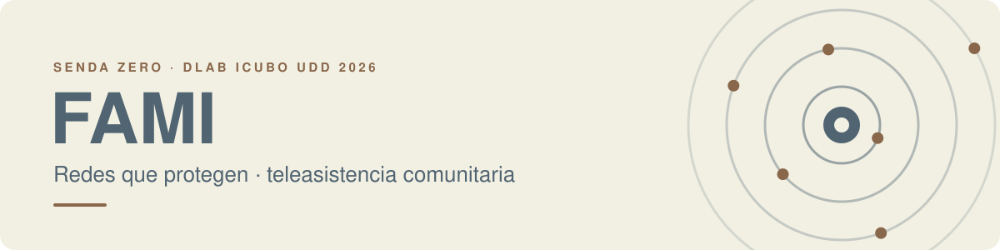

<p align="center"></p>

# 🛡️ FAMI: Redes que Protegen

-516472?style=for-the-badge)


> **Teleasistencia comunitaria e independiente para el adulto mayor.** Transformamos el aislamiento residencial y la desconexión territorial en una red de respuesta vecinal inmediata, sin depender de redes celulares comerciales ni costos fijos de telecomunicaciones.

Desarrollado por **Senda Zero** en el marco del programa interdisciplinario **dLab (Diseño, Ingeniería y Negocios)** de iCubo, Universidad del Desarrollo.

---

## 📋 Tabla de Contenidos

1. [El Problema y Contexto Territorial](#-1-el-problema-y-contexto-territorial)
2. [Propuesta de Valor: Ecosistema Bivalente](#-2-propuesta-de-valor-ecosistema-bivalente)
3. [Arquitectura Técnica y Hardware (BOM)](#-3-arquitectura-técnica-y-hardware-bom)
4. [Flujo de Conexión y Onboarding](#-4-flujo-de-conexión-y-onboarding)
5. [Validación en Terreno](#-5-validación-en-terreno)
6. [Cumplimiento Legal y Regulatorio](#-6-cumplimiento-legal-y-regulatorio)
7. [Modelo de Negocio y Estructura Financiera](#-7-modelo-de-negocio-y-estructura-financiera)
8. [Identidad Visual y Branding](#-8-identidad-visual-y-branding)
9. [Estructura Recomendada del Repositorio](#-9-estructura-recomendada-del-repositorio)
10. [Equipo Senda Zero](#-10-equipo-senda-zero)

---

## 🌍 1. El Problema y Contexto Territorial

En Chile, el envejecimiento demográfico avanza de forma acelerada, alcanzando una proporción de **175 adultos mayores por cada 100 menores de edad**. Sin embargo, la infraestructura de cuidado actual no responde a dos fenómenos críticos:

* **Síndrome de la Larga Permanencia:** Cuando un adulto mayor autovalente sufre una caída y permanece más de $1\text{ hora}$ en el suelo sin recibir asistencia, su tasa de mortalidad se duplica y aumenta drásticamente el riesgo de secuelas físicas y psicológicas irreversibles.
* **El "Segundo Sismo Social":** Ante catástrofes naturales o emergencias masivas, las redes celulares comerciales y los servicios centralizados colapsan, dejando completamente incomunicados e invisibles a los adultos mayores dentro de sus hogares.

### Contraste de Realidades Validadas
* **Contexto Rural Disperso (Caso de Estudio: Cobquecura):** Alta dispersión geográfica, zonas con silencio de cobertura celular y lejanía crítica respecto a centros de salud.
* **Contexto Urbano Denso (Piloto de Validación: Quinta Normal):** Comuna con **17.144 adultos mayores** (de un total de 129.351 habitantes), donde predomina el *"aislamiento a puertas cerradas"* debido a la pérdida de cohesión comunitaria, mientras sus hijos (la **Generación Sándwich**, de 35 a 50 años) trabajan a distancia bajo una angustia constante.

---

## 💡 2. Propuesta de Valor: Ecosistema Bivalente

FAMI rompe el paradigma de los dispositivos médicos invasivos que generan *"estigma de fragilidad"*, integrando hardware discreto con inteligencia comunitaria:

### 🔹 FAMI A: El Anclaje (Hardware Wearable)
* **Diseño Modular sin Estigma:** Dispositivo compacto y ergonómico fabricado en polímero flexible (TPU beige), adaptable como **pulsera, llavero o pin** según la preferencia estética del usuario.
* **Cero Fricción Cognitiva:** Sin pantallas complejas ni menús que intimiden al adulto mayor.
* **Independencia de Redes Móviles:** Opera mediante modulación de espectro libre **LoRaWAN ($915\text{ MHz}$)**, eliminando el uso de tarjetas SIM/eSIM y asegurando transmisión de largo alcance y ultra bajo consumo incluso durante cortes eléctricos o caídas de telefonía móvil.

### 🔹 FAMI B: La Vecindad (Software / Vecindapp)
* **Interfaz de 4 Cuadrantes:** Aplicación móvil diseñada en **React Native** para reducir la carga cognitiva del cuidador en momentos de pánico.
* **Identidad Biográfica:** Almacena información crítica para el rescate (preexistencias médicas, grupo sanguíneo, alergias y protocolos de acceso al domicilio).
* **Activación de los "Minutos de Oro":** Coordina de forma escalonada al **primer anillo de apoyo vecinal** (vecinos clave cercanos) y familiares directos, logrando asistencia presencial en minutos antes de la llegada de servicios de emergencia (CESFAM).

---

## ⚙️ 3. Arquitectura Técnica y Hardware (BOM)

### Flujo de Telemetría y Alertas

```text
[ Sensor MPU6050 / Botón SOS ] 
              │
              ▼
   [ MCU ESP32-C3 SuperMini ] ──► (Activa Faro Acústico / Buzzer Local)
              │
              ▼ (Modulación LoRaWAN 915 MHz - Sin SIM)
    [ Gateway Comunitario ]
              │
              ▼ (Backend Cloud / WebSockets Cifrados AES-256)
  [ App Vecindapp (4 Cuadrantes) ] ──► Alerta a Vecinos Cercanos + Familiares
```

### Lista de Materiales del Prototipo (BOM)

| Categoría | Componente | Especificación Técnica y Función |
| :--- | :--- | :--- |
| **Procesamiento** | ESP32-C3 SuperMini | Microcontrolador principal de ultra bajo consumo energético. |
| **Detección Pasiva** | MPU6050 | Acelerómetro y giroscopio de 6 ejes para detección automática de caídas. |
| **Geolocalización** | GPS NEO-6M | Módulo satelital con antena cerámica integrada para rastreo exterior. |
| **Localización Sonora** | Buzzer Activo Miniatura | Faro acústico de alta intensidad para ubicación rápida en pasajes o cités. |
| **Interfaz Física** | Botón SOS + USB-C | Pulsador mecánico de emergencia y puerto de carga estándar USB-C hembra. |
| **Energía** | Batería LiPo | Celda recargable de $3.7\text{ V}$ ($400\text{--}500\text{ mAh}$) con autonomía extendida. |
| **Conectividad** | Transceptor LoRaWAN | Comunicación inalámbrica en banda libre de $915\text{ MHz}$. |
| **Estructura** | PCB + Carcasa TPU | Placa de circuito impreso doble capa personalizada y carcasa modular ergonómica. |

> **Nota de Arquitectura de Software (MVP):** Para la validación ágil en terreno sin depender del despliegue masivo de pasarelas físicas iniciales, la aplicación implementa un **Contrato de Datos Estricto en JSON (*Edge Mocking*)** que simula telemetría en tiempo real, preparado para escalar de forma transparente hacia WebSockets productivos.

---

## 📲 4. Flujo de Conexión y Onboarding

El emparejamiento entre el dispositivo físico y la red familiar/vecinal está diseñado para completarse en menos de 2 minutos:

1. **Escaneo de Código QR:** El cuidador escanea el código único impreso en el reverso de FAMI para vincular y cifrar la *Identidad Biográfica* del adulto mayor.
2. **Sincronización Bluetooth / NFC:** Aproximación inicial de corto alcance para emparejar el microcontrolador con el teléfono móvil y verificar estado de batería y sensores.
3. **Configuración de la Red Vecinal:** Invitación directa a familiares y vecinos de confianza que conformarán el anillo de respuesta rápida en el mapa comunitario.

---

## 📊 5. Validación en Terreno

El proyecto fue iterado en **4 ciclos de co-diseño** y validado cuantitativa y cualitativamente en la comuna de Quinta Normal:

* **89% de Utilidad Percibida:** El $89\%$ de los encuestados calificó el ecosistema FAMI como *"extremadamente útil"* o *"muy útil"* para resolver la inseguridad de adultos mayores que viven solos.
* **Validación de Usuario (Adulto Mayor):** Aceptación total del formato modular (pulsera/llavero/pin) al no percibirse como un artículo ortopédico o de vigilancia intrusiva.
* **Validación de Cliente (Generación Sándwich):** Alta disposición a financiar la solución como herramienta de reducción de ansiedad y culpa a distancia.
* **Validación de Expertos (Gestión de Riesgo):** Reconocimiento del valor estratégico de **LoRaWAN** como canal redundante resiliente ante catástrofes sísmicas.

---

## ⚖️ 6. Cumplimiento Legal y Regulatorio

Para su comercialización y despliegue institucional en Chile, la arquitectura cumple con tres marcos normativos clave:

* **SUBTEL (Subsecretaría de Telecomunicaciones):** Homologación de radiofrecuencia para operar dentro de los límites de potencia permitidos en la banda libre de $915\text{ MHz}$.
* **SEC (Superintendencia de Electricidad y Combustibles):** Certificación de seguridad eléctrica para el circuito impreso (PCBA), gestión de batería LiPo y protocolo de carga USB-C.
* **Ley N° 19.628 (Protección de la Vida Privada):** Protección de datos sensibles de salud y geolocalización mediante cifrado simétrico de extremo a extremo (**AES-256**) y respeto a los derechos **ARCOP**.

---

## 💰 7. Modelo de Negocio y Estructura Financiera

FAMI opera bajo un **modelo híbrido (Hardware + SaaS)** que transiciona hacia ingresos recurrentes de alto margen:

### Esquema de Precios (Validado con Gabor-Granger y Van Westendorp)
* **Venta Única de Hardware (FAMI A):** $\$99.990\text{ CLP}$ (pago único por dispositivo).
* **Suscripción Digital (FAMI B / Vecindapp):** $\$7.990\text{ CLP/mes}$ (continuidad operativa de red, alertas y soporte).

### Estructura de Costos y Punto de Equilibrio

$$\text{Costo Unitario (COGS)} = \underbrace{\$30.000}_{\text{Manufactura PCBA}} + \underbrace{\$6.800}_{\text{Servidores (3 años)}} = \$36.800\text{ CLP}$$

$$\text{Costo Total Operativo} = (\$36.800 \times N) + \$1.568.000\text{ CLP/mes (OpEx Fijo)}$$

* **Escalamiento de Manufactura:** En fase piloto (500 uds) se utiliza un esquema mixto ($50/50$), migrando a manufactura completa en volumen a partir de las $1.000\text{--}5.000\text{ unidades}$, lo que eleva el margen bruto del hardware por sobre el **$83.3\%$**.
* **Punto de Equilibrio (Break-Even):** Se alcanza de forma consolidada entre el **mes 18 y el mes 24** de operación.
* **Punto de Inflexión SaaS (Año 4 / 2029):** Los ingresos recurrentes por suscripción de software ($\$239\text{M CLP}$) superan por primera vez a las ventas transaccionales de hardware ($\$170\text{M CLP}$), consolidando un margen operativo neto de software de hasta **$82\%$**.
* **Expansión B2B / B2G (Año 2+):** Incorporación de convenios con Municipalidades, CESFAM y Mercado Público tras consolidar la red piloto B2C durante el primer año.

### Dimensionamiento de Mercado (Chile)
* **TAM (Mercado Total Direccionable):** $\sim 980.000$ personas ($72\text{--}85$ años) $\rightarrow$ $\$191.952\text{M CLP}$.
* **SAM (Mercado Disponible Servible):** $\sim 25.166$ personas autovalentes en aislamiento $\rightarrow$ $\$4.929\text{M CLP}$.
* **SOM (Mercado Objetivo Capturable):** $\sim 12.583$ hogares prioritarios con red familiar $\rightarrow$ $\$2.465\text{M CLP}$.

---

## 🎨 8. Identidad Visual y Branding

El sistema de diseño transmite calidez humana, cercanía y confianza tecnológica:

* **Tipografía Principal:** `Arista Pro` (con respaldo redondeado `Fredoka` / `Nunito` para entornos web).
* **Paleta de Colores:**

| Rol Visual | Nombre | Código Hexadecimal | Uso Principal |
| :--- | :--- | :--- | :--- |
| **Base / Fondo** | Beige Marfil | `#f2f0e3` | Fondo general de interfaces y lienzos limpios. |
| **Acento Principal** | Azul Resiliente | `#516472` | Tipografía principal, botones de acción (CTA) e iconos técnicos. |
| **Acento Secundario** | Café Tierra | `#89674b` | Detalles de marca, énfasis cálidos y elementos de hardware. |
| **Contenedores** | Café Claro / Arena | `#e1d7c8` | Tarjetas de información, modales y secciones secundarias. |

---

## 📁 9. Estructura Planificada del Repositorio

> Hoy el repositorio contiene esta documentación; las carpetas siguientes son el plan para ir sumando cada componente.

```text
fami-redes-que-protegen/
├── 📁 hardware/                 # Esquemas PCB, modelos 3D (.STL) de carcasa modular y BOM
├── 📁 firmware/                 # Código fuente C++/Arduino para ESP32-C3, MPU6050 y LoRaWAN
├── 📁 app-vecindapp/            # Código fuente React Native (UI 4 cuadrantes y Edge Mocking JSON)
├── 📁 web-landing/              # Página web informativa (index.html, styles.css, script.js)
├── 📁 docs/                     # Informe final de innovación, validación comercial y láminas dLab
└── 📄 README.md                 # Documentación principal del proyecto
```

---

## 👥 10. Equipo Senda Zero

Proyecto desarrollado en **dLab — iCubo, Universidad del Desarrollo (2026)**:

* **Agustín Bravo**
* **Catalina Larrive**
* **Diego Herrera**
* **Daniel Merino**
* **Piera Semprevivo**

**Tutor Guía:** Pablo Boraquevich.

---
*FAMI no solo detecta emergencias; reconstruye el tejido comunitario que nos cuida.*